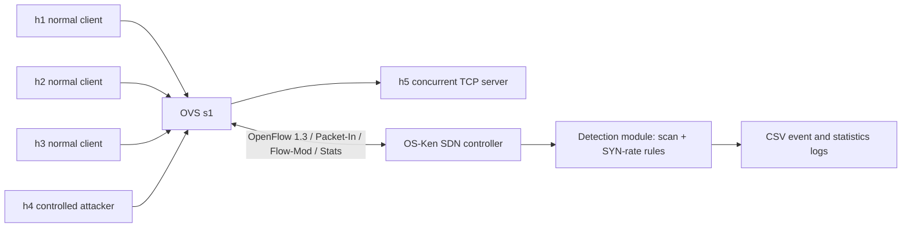

# Architecture

The controller observes packets using a table-miss rule and forwards non-blocked traffic
with Packet-Out. On a rule match it installs a higher-priority IPv4-source drop rule with
a hard timeout. The application uses Python's standard `socket` module.
